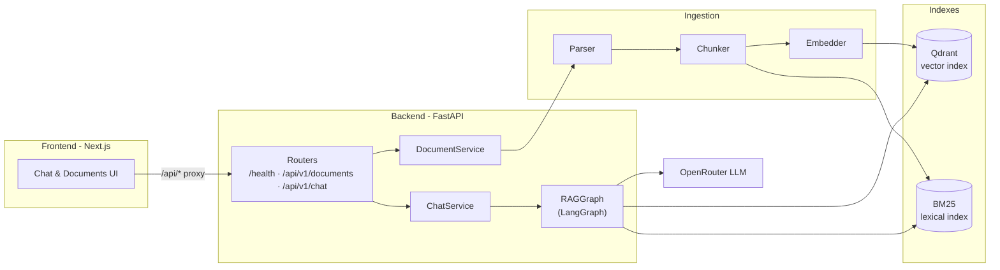
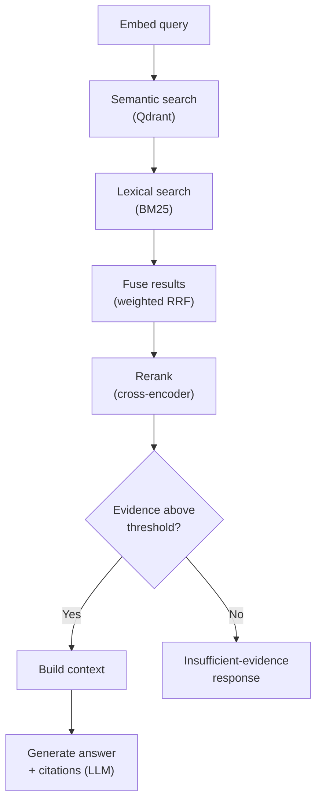

<div align="center">

# Luma

**Evidence-based AI for your documents.**

Upload documents, ask questions in natural language, and get answers grounded in the source text with inline citations.

[](https://www.python.org/)
[](https://fastapi.tiangolo.com/)
[](https://www.langchain.com/)
[](https://langchain-ai.github.io/langgraph/)
[](https://nextjs.org/)
[](https://react.dev/)
[](https://www.typescriptlang.org/)
[](https://tailwindcss.com/)
[](https://qdrant.tech/)
[](#license)

</div>

---

## Overview

Luma is a document intelligence platform built on a full Retrieval-Augmented Generation (RAG) pipeline. Documents are parsed, chunked, embedded, and indexed; queries run through hybrid retrieval and cross-encoder reranking; and an LLM generates an answer with numbered citations pointing back to the source document and page.

The retrieval-to-generation flow is orchestrated as a [LangGraph](https://langchain-ai.github.io/langgraph/) state graph, giving each stage a clear, testable node boundary. The default configuration runs entirely locally: Qdrant runs in-memory and only LLM generation requires an external service ([OpenRouter](https://openrouter.ai/)).

## Features

- **Hybrid retrieval**: dense vector search (Qdrant) fused with sparse BM25 keyword search via weighted Reciprocal Rank Fusion (RRF).
- **Cross-encoder reranking**: top candidates are rescored with `cross-encoder/ms-marco-MiniLM-L-6-v2` for higher-precision evidence.
- **Inline citations**: answers reference the source document and, for PDFs, the page number.
- **Evidence gating**: if no evidence clears the minimum relevance threshold after reranking, Luma returns an "insufficient evidence" response instead of guessing.
- **Streaming responses**: answers stream token-by-token over Server-Sent Events.
- **Runtime model selection**: pick any OpenRouter model per query; free models are listed first.
- **Non-blocking ingestion**: parsing, chunking, embedding, and indexing run in a thread pool so uploads return immediately with `processing` status.
- **Multi-format parsing**: PDF (page-aware), DOCX, TXT, Markdown, and CSV.
- **In-memory by default**: no external database required for local development.

## Tech Stack

| Layer | Technology |
|-------|-----------|
| Backend | FastAPI, Python 3.11+, Pydantic v2, uvicorn |
| RAG orchestration | LangChain, LangGraph |
| Frontend | Next.js 16, React 19, TypeScript, Tailwind CSS 4, Motion |
| Embeddings | sentence-transformers (`all-MiniLM-L6-v2`, 384-dim) |
| Reranking | HuggingFace cross-encoder (`ms-marco-MiniLM-L-6-v2`) |
| Vector store | Qdrant (in-memory or server) |
| Lexical search | BM25 (`rank-bm25`) |
| LLM | OpenRouter (any supported model) |
| Document parsing | pypdf, python-docx |
| Logging | structlog |
| Tooling | uv, hatchling, Ruff, mypy |

## Architecture



The backend wires its components through a dependency-injection container (`backend/core/container.py`) that lazily initializes each service. The `/api/*` path from the frontend is proxied to the backend via a Next.js rewrite.

### RAG query pipeline



RRF fuses the two result lists with a semantic/lexical weight of `0.6`/`0.4` (constant `k = 60`), avoiding score normalization across the two search methods. After reranking, evidence scoring below the minimum relevance threshold is dropped; if nothing remains, the pipeline short-circuits to the insufficient-evidence response.

## Prerequisites

- Python 3.11+
- Node.js 18+
- [uv](https://docs.astral.sh/uv/) (recommended) or pip
- An [OpenRouter API key](https://openrouter.ai/keys) (free tier available)
- Qdrant (optional; defaults to in-memory mode)

## Installation

```bash
# Clone
git clone https://github.com/<your-username>/luma.git
cd luma

# Backend dependencies
uv sync                 # or: pip install -e ".[dev]"

# Environment
cp .env.example .env    # then edit .env with your OpenRouter key

# Frontend dependencies
cd frontend
npm install
```

## Environment Variables

Copy `.env.example` to `.env` in the project root. `OPENROUTER_API_KEY` is the only value required to generate answers; every other variable has a working default.

| Variable | Default | Description |
|----------|---------|-------------|
| `APP_ENV` | `development` | Environment (`development`, `staging`, `production`) |
| `APP_DEBUG` | `True` | Enable debug mode and auto-reload |
| `APP_HOST` | `0.0.0.0` | Server bind address |
| `APP_PORT` | `8000` | Server port |
| `OPENROUTER_API_KEY` | (none) | OpenRouter API key (required for LLM generation) |
| `HF_API_TOKEN` | (none) | Hugging Face token for higher model-download rate limits (optional) |
| `EMBEDDING_MODEL` | `sentence-transformers/all-MiniLM-L6-v2` | Embedding model |
| `EMBEDDING_DIMENSION` | `384` | Embedding vector dimensionality |
| `LLM_MODEL` | `meta-llama/llama-3.1-8b-instruct` | Default LLM model |
| `LLM_MAX_TOKENS` | `1024` | Max generation tokens |
| `LLM_TEMPERATURE` | `0.1` | Sampling temperature |
| `QDRANT_URL` | `:memory:` | Qdrant URL (`:memory:` for in-memory, `http://localhost:6333` for a server) |
| `QDRANT_API_KEY` | (none) | Qdrant API key (for Qdrant Cloud) |
| `QDRANT_COLLECTION_NAME` | `luma_documents` | Qdrant collection name |
| `RETRIEVAL_TOP_K` | `10` | Candidates retrieved per method before reranking |
| `RERANK_TOP_K` | `5` | Results kept after reranking |
| `CHUNK_SIZE` | `512` | Target chunk size in characters |
| `CHUNK_OVERLAP` | `64` | Overlap between chunks in characters |
| `UPLOAD_DIR` | `./uploads` | Upload storage directory |
| `MAX_UPLOAD_SIZE_MB` | `50` | Maximum upload size in megabytes |

## Development

Run the backend and frontend in separate terminals.

```bash
# Terminal 1: backend (http://localhost:8000)
uv run uvicorn backend.main:app --reload
```

```bash
# Terminal 2: frontend (http://localhost:3000)
cd frontend
npm run dev
```

The frontend proxies `/api/*` requests to the backend at `http://localhost:8000`. Interactive API docs are served at `http://localhost:8000/docs`.

### Quality checks

```bash
# Lint and format the backend
uv run ruff check backend/
uv run ruff format backend/

# Type-check the backend
uv run mypy backend/

# Lint and build the frontend
cd frontend
npm run lint
npm run build
```

## API

Base path for application routes is `/api/v1`. The health check is served at the root.

| Method | Path | Description |
|--------|------|-------------|
| `GET` | `/health` | Health check (status + version) |
| `POST` | `/api/v1/documents` | Upload a document (multipart form) |
| `GET` | `/api/v1/documents` | List all documents |
| `GET` | `/api/v1/documents/{id}` | Get document details |
| `DELETE` | `/api/v1/documents/{id}` | Delete a document and its indexed data |
| `POST` | `/api/v1/chat` | Query documents (returns answer + citations) |
| `POST` | `/api/v1/chat/stream` | Query with SSE token streaming |
| `GET` | `/api/v1/chat/models` | List available OpenRouter models (free first) |

### Supported file types

PDF (page-aware), DOCX, TXT, Markdown (`.md`), and CSV.

## Project Structure

```
├── backend/
│   ├── main.py            # Uvicorn entry point
│   ├── api/               # FastAPI app factory, routers, DI dependencies
│   ├── core/              # Config, exceptions, logging, DI container
│   ├── generation/        # LLM client, LangGraph RAG pipeline, prompts
│   ├── ingestion/         # Parser, text chunker, embedder
│   ├── models/            # Pydantic schemas (documents, chunks, queries)
│   ├── repository/        # Qdrant vector store, document file storage
│   ├── retrieval/         # BM25 search, hybrid RRF fusion, cross-encoder reranker
│   └── services/          # Document and chat orchestration services
├── frontend/
│   └── src/
│       ├── app/           # Next.js pages (home, chat, documents)
│       ├── components/    # UI components (upload, cards, navigation)
│       ├── hooks/         # Document processing state hook
│       └── lib/           # Typed API client
├── pyproject.toml         # Python dependencies and tooling config
└── .env.example           # Environment variable template
```

## Deployment

**Backend.** Build the package with hatchling (`uv build`) or run `backend.main:app` with any ASGI server. For production, disable debug and run without reload:

```bash
APP_DEBUG=False uv run uvicorn backend.main:app --host 0.0.0.0 --port 8000
```

Set `QDRANT_URL` to a persistent Qdrant server (e.g. `http://localhost:6333` or a Qdrant Cloud URL with `QDRANT_API_KEY`) so indexed data survives restarts; the default `:memory:` store is cleared on every restart.

**Frontend.** Build and serve the Next.js app:

```bash
cd frontend
npm run build
npm run start
```

Point the frontend's `/api/*` rewrite (`frontend/next.config.ts`) at your deployed backend before building.

## License

MIT
